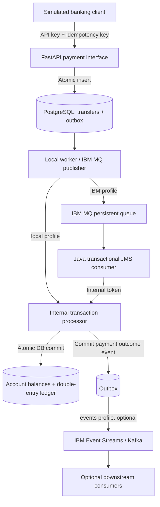

# BankBridge: Enterprise Banking Integration Platform

**A runnable, synthetic payment integration reference implementation combining a transactional banking ledger, durable outbox, optional IBM MQ JMS processing, optional IBM Event Streams/Kafka publishing, and OpenShift deployment templates.**

> **Important accuracy statement:** This repository is NOT a full deployed IBM Cloud Pak for Integration (CP4I) environment and does not process real financial transactions. The Python core and its automated tests run without proprietary software. IBM MQ Developer mode, IBM App Connect Enterprise (ACE), API Connect, IBM Event Streams and OpenShift are *separate integrations* requiring appropriate runtimes, credentials and hands-on verification. The ACE ESQL is a Toolkit example, not a deployable `.bar` file. Do not call unexecuted integrations tested.

## Demo in 2 commands

Prerequisites: Docker Engine + Docker Compose plugin, Python 3 (only for helper scripts), `curl`, and sufficient memory for PostgreSQL and two small Python containers.

```bash
bash scripts/demo.sh
```

The script creates a private `.env` with randomized secrets if needed, builds the **local** profile, starts PostgreSQL + API + local outbox worker, and executes a **real HTTP smoke test** that posts a new transfer, polls it, replays the idempotency key, and checks both balances. Repeat as many times as you like: `bash scripts/smoke-test.sh`.

Open [http://127.0.0.1:8000/docs](http://127.0.0.1:8000/docs) to explore the interactive API. All accounts are fictional. Stop with:

```bash
docker compose --profile local down
```

To remove test data permanently (irreversible): `docker compose --profile local down -v`.

### Manual API example

```bash
# The demo script creates .env automatically. If needed, first run it once.
set -a; source .env; set +a
curl -fsS http://127.0.0.1:8000/v1/accounts/DEMO-100 -H "X-API-Key: $BANKBRIDGE_API_KEY"
curl -fsS -X POST http://127.0.0.1:8000/v1/transfers \
  -H "Content-Type: application/json" \
  -H "X-API-Key: $BANKBRIDGE_API_KEY" \
  -H "Idempotency-Key: $(python3 -c 'import uuid;print(uuid.uuid4())')" \
  -d @examples/payment.json
```

The transfer initially returns `PENDING` (HTTP 202), then the asynchronous local worker processes it. **Do not assume synchronous completion.**

## Architecture



* `POST /v1/transfers` atomically saves the transfer request and a `payment.requested` outbox event.
* The **local** profile processes the pending outbox directly; the **ibm** profile publishes to IBM MQ and consumes with JMS transactions. **Do not run both worker profiles simultaneously for a meaningful MQ demo.**
* The processor locks the transfer and account rows (PostgreSQL), then atomically writes balances, ledger entries, terminal status and outcome event. A redelivered transfer is detected and not applied again.
* The optional Kafka publisher sends `payment.completed`/`payment.rejected` and only marks events delivered after broker acknowledgement; duplicates remain possible after an ambiguous publish.
* Authentication in this demo is minimal: replace API keys with real gateway policies and mTLS / OAuth for any serious deployment.

## What the repo demonstrates

| Capability | Deliverable | Verification state |
|---|---|---|
| REST payment contract | FastAPI endpoints, Swagger docs, OpenAPI contract | Automated tests passed |
| Ledger correctness | Decimal amounts, atomic account changes, double-entry records | Automated tests passed |
| Duplicate delivery safety | API request idempotency + DB-side effect idempotency | Automated tests passed |
| Failure handling | Rejection on insufficient funds; MQ retries and poison queue design | Core tests passed; real MQ scenario untested |
| IBM MQ | REST persistent-message publisher + Java JMS transactional consumer | Code included; requires live MQ to verify |
| Event streaming | Kafka/IBM Event Streams producer and outbox acknowledgement | Mock-producer tests passed; real broker untested |
| IBM ACE | ESQL mapping example + integration server wiring guide | Example only; Toolkit build not executed |
| IBM API Connect | Portable OpenAPI 3 contract for import | Import not executed |
| Red Hat OpenShift | Deployment, Service, Route, example secrets, NetworkPolicy | Syntax parsed; cluster deployment not executed |
| Automation | Docker Compose profiles, smoke test, CI for Python and Java | Python tests run; Docker/Java build require external environment |

## IBM MQ Developer edition profile (optional)

1. Run the local demo at least once to create `.env` and verify the core.
2. Stop local worker with `docker compose --profile local stop local-worker`.
3. Launch `bash scripts/ibm-demo.sh` to start IBM MQ developer, outbox publisher, and Java JMS consumer, **without** the local worker.
4. Inspect logs: `docker compose --profile ibm logs -f mq mq-dispatcher mq-consumer`.
5. Only after the MQ API and consumer are ready, run `bash scripts/smoke-test.sh` and check the transaction reaches `COMPLETED` through MQ.

The MQ image is IBM's development-only image, not embedded in or redistributed by this repository. It may be large and is licensed by IBM. The selected version uses default developer queues `DEV.QUEUE.1` and `DEV.QUEUE.2`, and `DEV.APP.SVRCONN`. This example intentionally disables REST TLS certificate validation **only in the isolated dev profile** and does not configure JMS TLS. See [IBM MQ runbook](docs/runbooks/ibm-mq.md) for the exact constraints and troubleshooting.

## IBM Event Streams / Kafka (optional)

Set values in `.env` or your secret manager:

```ini
KAFKA_BOOTSTRAP_SERVERS=your-event-streams-bootstrap:9093
KAFKA_SECURITY_PROTOCOL=SASL_SSL
KAFKA_SASL_MECHANISM=PLAIN
KAFKA_USERNAME=token
KAFKA_PASSWORD=your-api-key
KAFKA_TOPIC=bankbridge.payments.v1
```

Create the Kafka topic and access policy, and start `docker compose --profile events up -d --build`. Only terminal payment events are published by this optional worker; `payment.requested` events are consumed by local or MQ processing. See [Kafka runbook](docs/runbooks/events.md).

## IBM ACE / API Connect / OpenShift

* [ACE integration template and limitations](docs/runbooks/ibm-ace.md)
* [API Connect import guide](docs/runbooks/api-connect.md)
* [OpenShift rollout instructions](docs/runbooks/openshift.md)
* [Architecture and sequence](docs/architecture/SYSTEM_DESIGN.md)
* [Design decisions](docs/architecture/ADRs.md)
* [Security and threat model](docs/SECURITY.md)
* [Test evidence & outstanding validation](docs/VERIFICATION.md)
* [Troubleshooting and failure exercises](docs/runbooks/failure-drills.md)
* [CV / interview talking points](docs/PORTFOLIO.md)
* [How to publish on GitHub](docs/GITHUB_PUBLISH.md)

## Quick local development without Docker

Requires Python 3.11+ and installed dependencies. Run two terminals:

```bash
python3 -m venv .venv
source .venv/bin/activate
python -m pip install '.[test]'
export ALLOW_DEMO_SEED=true
export BANKBRIDGE_API_KEY=local-demo-key-change-me
export BANKBRIDGE_INTERNAL_TOKEN=local-internal-token-change-me
uvicorn bankbridge.api:app --host 127.0.0.1 --port 8000
# In another terminal, with same venv and environment:
python -m bankbridge.worker local
```

The default DB is a local SQLite file (single worker only, demo development); PostgreSQL is required to rely on row-level locking under concurrency. Run tests with `python -m pytest -q`.

## Repo rules

* Only invented identifiers and synthetic account balances. **Never** import or share military, customer, or employer data.
* IBM artifacts, installation images, license files, and proprietary binaries are **not** checked in.
* `.env`, certificates, secrets, database files and build artifacts are excluded by `.gitignore`.
* The Apache/MIT licensing of this repository's own original code does **not** extend to IBM products.
* No production, financial, reliability, high-availability, performance or DR certification is claimed.

## Official references

* [IBM MQ Advanced for Developers container](https://www.ibm.com/docs/en/ibm-mq/9.3.x?topic=containers-mq-advanced-developers-container-image)
* [IBM MQ messaging REST API](https://www.ibm.com/docs/en/ibm-mq/9.3.x?topic=messagingqmgrqmgrnamequeuequeuenamemessage-post)
* [IBM MQ JMS examples](https://github.com/ibm-messaging/mq-dev-patterns)
* [ACE Docker image and entitlements](https://www.ibm.com/docs/en/app-connect/12.0.x?topic=cacerid-building-sample-or-supported-app-connect-enterprise-image-using-docker)

## License

Repository original source: MIT. See [LICENSE](LICENSE). IBM software is separately licensed.
